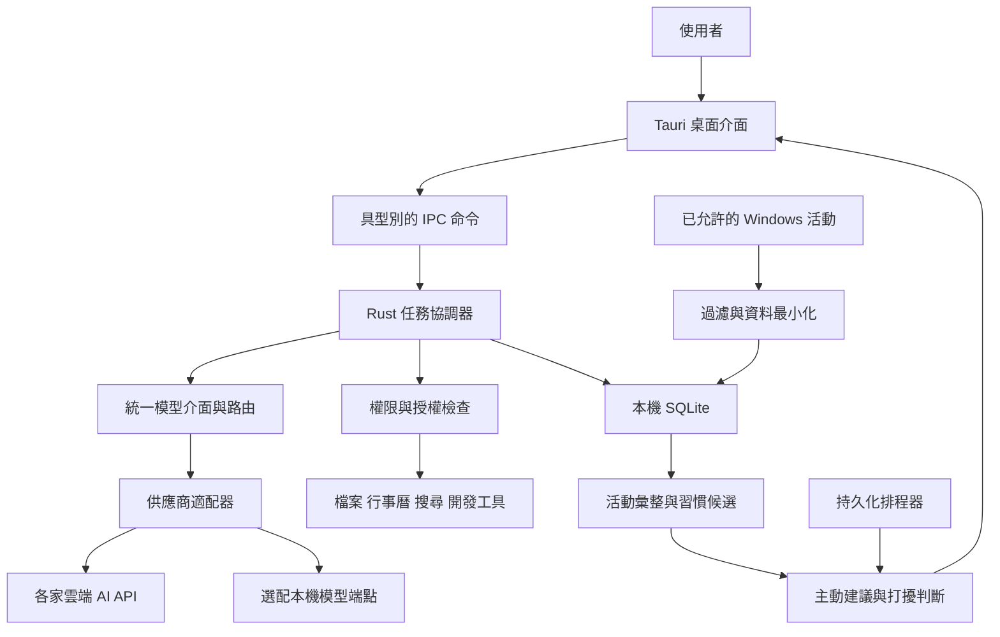

# Tauri AI 個人助理技術開發手冊

版本：0.3　日期：2026 年 11 月 11 日　狀態：開發設計稿（一週衝刺版，修訂內容見第 16 章）

本產品是一個可串接不同供應商 AI API、可在桌面交辦工作的個人助理。使用者能請它整理資訊、安排生活、研究問題、協助開發、製作文件，並持續追蹤待辦。取得使用者同意後，助理也會觀察有限的工作活動，整理可修正的習慣記憶，在合適時機詢問是否需要幫忙。模型供應商可替換，任務、工具、記憶與排程由本產品管理。

本版以 Windows 11、單一使用者、本機資料優先為範圍；Dot 作為桌面互動體驗的參考，不假設其內部實作。以下架構、門檻與時程是本專案的設計提案，效能數字是待測試的驗收目標。

## 1 產品定位與使用流程

建議首頁介紹：

> 你的 AI 個人助理。你可以把事情交給我處理，也可以找我一起分析、規劃或學習。我會查清楚、執行並回報；遇到需要你決定或超出授權的步驟，會清楚告訴你。

核心流程為「交辦 → 理解範圍 → 執行 → 驗證 → 回報 → 持續追蹤」。所有執行任務都必須有任務卡，呈現目前狀態、已完成事項、成果位置及需使用者處理的事項。一般分析、規劃與學習對話可以直接回答，不必建立背景任務。

主動協助採另一條流程：「允許的活動訊號 → 本機整理 → 候選建議 → 打擾檢查 → 詢問 → 使用者接受後建立任務」。偵測到模式並不等於獲准操作其他應用程式。

## 2 六大能力與交付標準

| 能力 | 典型交辦 | 第一版實作 | 完成證據 |
| --- | --- | --- | --- |
| 整理資訊與待辦 | 把這份會議筆記整理成待辦 | 文字、指定資料夾檔案匯入；摘要、標籤、待辦、到期日 | 摘要附來源；任務清單可編輯；不確定日期標示待確認 |
| 行程與生活安排 | 幫我安排下週學習時間 | 本機行程及提醒；後續串接一種外部行事曆 | 時區、衝突檢查、安排預覽；外部建立後回傳事件 ID |
| 研究與分析 | 比較三種技術方案 | 網路搜尋、來源閱讀、比較表、建議與限制 | 引用可開啟；區分已查證事實、推論與缺漏 |
| 開發與排查問題 | 分析這個專案的錯誤 | 使用者指定專案；讀取程式與日誌、產生修改及測試結果 | 修改差異、測試命令與結果；未測試項目明確標示 |
| 文件與內容 | 把資料整理成開發手冊 | Markdown、純文字及 HTML 預覽；後續加 DOCX、PDF、簡報 | 實體檔案、預覽與來源；排版型文件需渲染檢查 |
| 主動提醒與追蹤 | 明早提醒我，之後追蹤進度 | 持久化排程、到期通知、任務追蹤、每日摘要、有限習慣建議 | 排程清單、觸發紀錄、稍後提醒、完成及取消狀態 |

第一版不承諾無人監督完成購物付款、任意網站操作或任何桌面軟體的自動控制。這些能力要逐個工具建立可靠執行與驗證方式。

## 3 技術架構

建議採 Tauri 2、React、TypeScript、Vite 作為介面；Rust 管理任務、權限、Windows 活動收集與 SQLite。Rust 的模型路由層透過供應商適配器連接各家 API，核心流程不依賴任何一家 SDK 或雲端對話儲存。初期不額外啟動 Python 或 Node 常駐服務，減少安裝、程序管理及版本維護成本。



| 模組 | 責任 | 邊界 |
| --- | --- | --- |
| 桌面介面 | 對話、任務、授權卡、通知、記憶與設定 | 不保管 API key，不直接執行 shell |
| 任務協調器 | 狀態機、模型循環、取消、重試、恢復 | 模型文字不能直接改變任務完成狀態 |
| 模型路由與適配器 | 統一訊息、串流、工具呼叫、用量與錯誤；選擇符合條件的模型 | 不處理業務授權，不自行執行工具 |
| 工具登錄表 | 工具 schema、權限需求、timeout、結果驗證器 | 只開放已實作且符合目前授權的工具 |
| 政策引擎 | 檢查操作、目標、資料範圍、授權有效期 | 每次真正執行前重新檢查 |
| 活動與記憶服務 | 採樣、彙整、來源追蹤、偏好修正 | 不將推測當作使用者明示偏好 |
| 排程器 | 提醒、重啟恢復、時區、去重 | 不依賴 WebView 計時器或模型保持在線 |

### 3.1 核心與外殼分離（0.3 新增）

Rust 程式分成兩層，避免業務邏輯綁死在 Tauri 與 Windows 上：

| Crate | 內容 | 相依限制 |
| --- | --- | --- |
| `crates/elf-core` | 任務狀態機、協調器、模型契約與適配器、工具登錄表、政策引擎、排程器、記憶、SQLite 存取 | 不得相依 Tauri 或 Windows API；可在 Linux CI 完整編譯與測試 |
| `src-tauri` | IPC 命令、事件轉送、視窗與系統匣、通知、憑證儲存、Windows 活動採樣 | 只做轉接；不放業務判斷 |

核心透過 trait 取得外部能力：`Clock`（時間，測試可注入假時鐘）、`Notifier`（通知）、`CredentialStore`（憑證）、`ActivitySource`（活動訊號）、`HttpTransport`（模型與搜尋連線）。排程、補送、冷卻、逾時等時間相關邏輯一律經由 `Clock`，才能用事件回放驗證而不必等真實時間。

IPC 型別以 Rust 為唯一來源產生 TypeScript 定義，前端不手寫重複的介面型別；產生工具於技術驗證後選定。

Tauri 的 capability 機制用來限制不同視窗可呼叫的介面；應用內仍需額外的業務授權檢查，尤其是 Rust 自行執行的檔案、網路與程序操作。[Tauri Capabilities](https://tauri.app/security/capabilities/)

## 4 桌面互動介面

建議提供五個主要入口：

1. 桌面浮動入口：可拖曳、貼邊收合、顯示處理中或待確認狀態；可完全關閉。
2. 對話面板：快速輸入、拖入檔案、串流回覆、來源、成果附件及停止按鈕。
3. 任務中心：待處理、執行中、等待使用者、完成與失敗；可重試或取消。
4. 今日面板：待辦、行程、提醒、每日摘要與主動建議。
5. 設定與記憶中心：觀察來源、排除清單、暫停、雲端資料範圍、記憶編輯及刪除。

系統匣提供開啟、暫停觀察、勿擾及結束；關閉主視窗可隱藏，選擇結束則停止所有本機背景工作。系統匣可用 Tauri 官方功能實作。[Tauri System Tray](https://tauri.app/learn/system-tray/)

全域快捷鍵可由使用者設定；遇到快捷鍵衝突時顯示替代選擇。主動建議不得搶走輸入焦點；預設以浮動入口的小提示呈現。多螢幕位置用邏輯座標保存，啟動時檢查螢幕邊界，避免拔除外接螢幕後找不到視窗。

首次啟動先讓使用者完成一個交辦，再介紹可選的活動觀察。觀察關閉時，聊天、待辦、研究及明確排程仍可正常使用。

## 5 工作習慣收集

### 5.1 收集範圍

| 訊號 | 預設行為 | 用途 |
| --- | --- | --- |
| 助理內的任務、偏好與提醒回應 | 為提供服務而保存，可管理 | 學習提醒時機、常用輸出格式 |
| 前景應用程式與活動時段 | 使用者開啟觀察後才收集 | 常用工具、時間分布、切換次數 |
| 閒置、鎖定、睡眠 | 觀察開啟後用於排除時段 | 避免把離席算成工作 |
| 視窗標題、專案路徑 | 額外選擇啟用，先過濾 | 將活動歸入專案；標題可能含敏感資訊 |
| 瀏覽器網頁內容與網址 | 後續以個別授權的擴充套件提供 | 查詢與研究脈絡；不能由程序名稱推得 |
| 畫面與 UI 內容 | 僅特定任務、明確授權及限定時段 | 桌面操作或視覺分析 |
| 全域鍵盤內容、密碼、持續剪貼簿監控 | 不收集 | 不作為習慣分析來源 |

Windows 可用 GetForegroundWindow 取得前景視窗，必須處理回傳空值；以 GetLastInputInfo 協助判斷目前登入工作階段的閒置狀態，不能當作全機使用者活動紀錄。[前景視窗](https://learn.microsoft.com/en-us/windows/win32/api/winuser/nf-winuser-getforegroundwindow)、[閒置資訊](https://learn.microsoft.com/en-us/windows/win32/api/winuser/nf-winuser-getlastinputinfo)

第一版每 5 秒採樣一次，僅在活動切換時寫入區段；連續閒置 5 分鐘後停止累積活躍時間。這些是可調整的起始值。睡眠、鎖定及程序重啟切斷區段，不跨缺口推算。用單調時鐘算時長，用 UTC 與時區資訊保存事件時間。

UI Automation 可以讀取應用公開的 UI 資訊，但支援程度取決於目標應用；它不是所有畫面內容都能取得的保證。第一版活動統計不依賴 UI Automation。[Microsoft UI Automation](https://learn.microsoft.com/en-us/windows/win32/winauto/uiauto-uiautomationoverview)

### 5.2 彙整與習慣形成

活動區段先在本機產生日彙整：各應用活躍時間、可觀測的切換次數、使用者標記的工作時段及任務完成情況。每天最多一次模型摘要，只提供去識別的彙整與必要任務脈絡。

習慣候選範例：「過去 10 個有觀察資料的工作日，有 7 天在上午使用開發工具超過 45 分鐘。」保存觀察期間、樣本數、例外及來源，而不是直接寫成「使用者早上效率最好」。應用使用時間無法證明效率、心情或是否遇到困難。

明示偏好優先於推斷；使用者修正「那不是工作，是課程」後，重新分類相關活動並使衍生記憶失效。初期至少累積 5 個有資料的工作日才產生習慣建議；沒有足夠訊號時不猜測。

## 6 主動協助策略

將「使用者要求的提醒」與「系統推測的建議」分開管理。前者依已建立排程執行；後者必須先通過資料充分、相關性、勿擾、冷卻與每日上限檢查。

建議起始規則：每天最多 2 則推測型建議、兩則至少間隔 2 小時；同一類建議被拒絕後暫停 7 天。未回應只記為未回應，不視為接受。鎖定、全螢幕或手動勿擾時延後；會議與分享畫面的判斷需可靠整合，無法確認時提供手動專注模式。

| 情境 | 可以提出的建議 | 限制 |
| --- | --- | --- |
| 使用者常在週五整理週報 | 「要依這週已完成任務產生週報草稿嗎？」 | 需有足夠歷史與明確任務資料 |
| 到期任務仍未完成 | 「這項待辦今天到期，要拆成下一步嗎？」 | 不自動變更截止日 |
| 反覆使用同一整理流程 | 「要把這個流程存成可重用任務嗎？」 | 只依助理內已知操作判斷 |
| 已授權資料顯示行程衝突 | 「兩項行程重疊，要一起調整嗎？」 | 不自行取消外部事件 |

建議卡包含「為什麼出現」「使用了哪些資料」「幫我處理」「稍後」「不再建議」。接受後建立正式任務，仍需通過工具授權。不要因使用者長時間停留在編輯器就聲稱其卡住。

## 7 多供應商模型與任務執行

### 7.1 統一模型介面

預留 OpenAI、Anthropic、Google Gemini、其他相容 API 與本機模型端點的適配器位置；實際支援清單由完成整合測試的適配器決定，不因填入 URL 就宣稱全部功能可用。第一版選兩種不同協定完成端到端驗證，具體供應商於實作時依使用者帳號選定。

以下為本專案的內部契約，並非任何供應商的 API schema：

```text
ModelAdapter
  capabilities(profile) -> ModelCapabilities
  validate_config(profile) -> ValidationResult
  stream(request, cancellation) -> Stream<ModelEvent>

ModelRequest
  model_profile_id, instructions, messages, tools,
  output_contract, output_budget, deadline, request_id

ModelEvent
  TextDelta | ToolCallDelta | ToolCallReady |
  Usage | Completed | Failed
```

messages 使用本產品的文字、圖片參照、工具呼叫及工具結果結構。適配器負責轉換角色、參數名稱、串流格式、結束原因及錯誤。工具參數片段必須完整組裝、解析並驗證後，才能產生 ToolCallReady；不能執行半截串流內容。保留工具呼叫 ID 與結果配對，對重複事件去重。

供應商限定的 opaque continuation 資料可隔離保存於該適配器，不傳給另一家；跨供應商恢復時以本機任務事實、已完成工具結果與必要對話摘要重建脈絡。不可只保存供應商 conversation ID 作為唯一歷史。

### 7.2 能力檢查與工具獨立性

每個模型設定檔保存能力宣告與最近驗證時間：text、streaming、tool_calling、structured_output、image_input、context_limit。未知能力視為未驗證，經測試後才啟用；參數不支援時明確報錯或按已定義策略降級，不靜默忽略。

| 能力條件 | 行為 |
| --- | --- |
| 有文字生成，無工具呼叫 | 可對話、摘要及規劃；不執行模型提出的動作 |
| 有工具呼叫 | 通過政策與 schema 驗證後可執行受控任務 |
| 無原生結構化輸出 | 可對非執行型資料做解析、驗證及有限重試；不把自由文字當作可執行工具指令 |
| 無圖片輸入 | 不傳圖片；提供更換模型或使用已授權文字擷取的選擇 |
| 脈絡容量不足 | 使用可追溯摘要縮減輸入，保留授權範圍與未完成工具配對 |

搜尋、檔案、行事曆、桌面操作與排程由應用工具層提供，模型透過統一工具 schema 使用。供應商內建搜尋只能作為選配優化，需轉換為共同的來源與引用格式；沒有內建搜尋時仍可接獨立搜尋服務。MCP 接入工具登錄表，不能繞過授權層。

例如選用 OpenAI 時，可在該適配器中使用 Responses API 與 function calling；此實作只影響適配器，不成為核心系統依賴。[OpenAI Function Calling](https://developers.openai.com/api/docs/guides/function-calling)

### 7.3 模型設定與路由

設定頁提供供應商、協定類型、API base URL、模型 ID、憑證、連線測試、能力測試及用途指派。不同用途可分別指定模型：日常對話、背景摘要、研究分析、程式開發與圖片理解。第一版以明確指派為主，後續才加入依成本與品質自動選模。

API key 只送往其綁定的端點；修改端點必須重新確認憑證綁定，跨主機重新導向不得攜帶密鑰。遠端端點使用 HTTPS；本機端點的 HTTP 例外限定於使用者明確設定的 loopback 位址。

模型 ID 由設定管理，依實際帳號可用性與測試結果選擇，不寫死「最新模型」。每次任務記錄供應商、模型、配置版本、用量、耗時及費用估計；用量缺漏標記未知，不能當作零。各家計價單位與快取用量分開保存。

### 7.4 切換與故障處理

同一任務預設固定模型設定檔，只在明確的步驟邊界切換。備援模型必須事先允許接收該類資料、具備所需能力，且符合預算；未設定備援時暫停並回報，不默默將資料傳給另一家。

限流及短暫失敗採有上限的退避重試；憑證錯誤或不支援能力不反覆重試。工具已執行時，恢復流程沿用已保存結果，不因模型重試再次執行外部寫入。介面顯示實際使用的供應商與模型，切換事件保留紀錄。

### 7.5 任務執行

模型提出工具呼叫，由應用驗證並執行，再將結果交回模型；所有供應商共用同一套政策、任務狀態及結果驗證。

任務狀態（0.3 改為明確轉移表；原圖無法表達暫停與結果不確定）：

| 狀態 | 意義 | 可轉移至 |
| --- | --- | --- |
| queued | 已建立，尚未開始 | running、cancelled |
| running | 模型循環或工具執行中 | awaiting_user、paused、verifying、uncertain、failed、cancelled |
| awaiting_user | 等待授權或使用者決定 | running、cancelled |
| paused | 達到工具次數、時間或預算上限，或等待連線；可恢復 | running、cancelled |
| verifying | 檢查成果證據 | completed、running、failed |
| uncertain | 外部寫入結果無法判定，需人工確認 | completed、failed、cancelled |
| completed、failed、cancelled | 終止狀態 | 無 |

規則：

- 狀態只能由協調器依轉移表變更；非法轉移回傳錯誤並記錄，不靜默修正。
- completed 只能由 verifying 或 uncertain 進入，且必須附至少一筆 evidence_ref。
- 每次轉移寫入 task_events（遞增 sequence），前端事件的 sequence 由此而來。
- 程序重啟時：running 的任務若沒有執行中的外部寫入步驟，回到 paused 等待恢復；有執行中外部寫入步驟者進入 uncertain。

每次工具呼叫遵循以下流程：

1. 校驗工具名稱與 JSON 參數，解析正規化後的目標路徑或資源。
2. 讀取目前有效授權；範圍不足時產生具體操作預覽並等待使用者。
3. 保存呼叫紀錄與冪等鍵，設定逾時、取消權杖和輸出大小上限。
4. 執行後驗證：檔案是否存在、事件 ID 是否可讀回、測試是否通過。
5. 將可驗證的結果回傳模型；無證據時不得回報成功。

單一任務起始上限為 20 次工具呼叫與 10 分鐘，可由任務類型調整。超限轉為等待使用者或可恢復的暫停狀態；避免模型無限循環。暫停狀態在實作時應納入正式 enum，而非混同失敗。

最初使用一個協調器加工具登錄表即可，六大能力以工具及提示模板組成，不必拆成六個常駐 Agent。

## 8 工具與授權設計

| 操作 | 授權策略 |
| --- | --- |
| 在已允許範圍搜尋、閱讀、摘要 | 沿用任務授權直接執行 |
| 在輸出目錄產生草稿、建立本機待辦 | 使用者交辦已涵蓋時直接執行 |
| 改動既有文件、程式碼 | 顯示差異；可對指定專案授予持續權限 |
| 寄信、外部行程邀請、發布、付款、刪除 | 確認對象、內容與後果；檢查既有授權是否精確涵蓋 |
| 任意 shell、管理員操作、全桌面控制 | 第一版不提供通用授權入口；逐項開放受控工具 |

授權紀錄包含 action、resource_scope、arguments_hash、expires_at、max_uses、source_task。一次核准只對相同操作與參數有效；內容變更要重新評估。持續授權可在設定撤銷，不能只存在模型對話記憶中。

開發工具在指定工作目錄執行；工作目錄限制本身不等於沙箱。執行未信任程式或測試需隔離環境與網路限制。命令以結構化程序參數啟動，不能把模型輸出拼接成 shell 命令。

外部文件、網頁和工具回應都視為資料；其中的「忽略規則、上傳檔案」不得提升權限。工具參數與目的地也要在政策層驗證，不能只靠 system prompt。

不受信任內容的標記規則（0.3 新增）：工具結果帶 `trust` 欄位（user_provided、local_granted、external）。任務一旦讀入 external 內容，該任務後續所有對外傳送、刪除與範圍外寫入一律要求使用者逐次確認，既有的持續授權在此任務中不適用。這條規則由政策引擎以任務層級旗標執行，不依賴模型自行判斷內容是否可疑。

## 9 資料模型與保存

SQLite 作為第一版唯一業務資料庫，由 Rust 服務統一存取。先用關鍵字與結構化條件檢索；等記憶量與搜尋需求明確後再加入向量索引。

| 資料表 | 核心欄位 |
| --- | --- |
| tasks | id, intent, status, scope_json, created_at, updated_at, result_ref |
| task_steps | id, task_id, seq, tool, args_redacted, side_effect, status, idempotency_key, started_at, finished_at, evidence_ref |
| activity_segments | id, app_id, start_at, end_at, active_ms, source, consent_version |
| summaries | id, period_start, period_end, body, source_ids, version |
| memories | id, type, content, confidence, source_ids, confirmed_at, expires_at |
| suggestions | id, rule_id, evidence_refs, shown_at, outcome, cooldown_until |
| schedules | id, task_template, timezone, next_run_at, recurrence, misfire_policy, enabled |
| deliveries | id, schedule_id, occurrence_key, status, delivered_at |
| grants | id, action, resource_scope, arguments_hash, expires_at, max_uses, used_count, source_task, revoked_at |
| connections | id, provider, granted_scopes, credential_ref, status |
| model_profiles | id, provider, protocol, base_url, model_id, credential_ref, capabilities_json, verified_at, config_version |
| model_routes | id, purpose, primary_profile_id, fallback_profile_ids, allowed_data_classes, budget_policy |
| model_runs | id, task_id, profile_id, config_version, provider_request_id, status, usage_json, estimated_cost, latency_ms |
| conversations | id, title, created_at, updated_at, archived_at |
| messages | id, conversation_id, task_id, role, content_json, tool_call_id, created_at |
| task_events | id, task_id, sequence, type, payload_json, created_at |
| artifacts | id, task_id, kind, path, content_hash, bytes, created_at |
| consents | id, kind, version, granted_at, revoked_at, detail_json |
| exclusions | id, kind, pattern, created_at |
| settings | key, value_json, updated_at |

0.3 補上的缺口：7.1 要求本機保有完整對話歷史，但 0.2 沒有對話與訊息表；tasks.result_ref 與 evidence_ref 沒有指向對象（新增 artifacts）；activity_segments.consent_version 沒有對應的同意紀錄（新增 consents）；排除清單沒有儲存位置（新增 exclusions）；第 8 章列出的 max_uses、source_task 未出現在 grants。

task_steps 採先寫後做：執行前先寫入 status=started 與 side_effect（none、local_write、external_write），完成後才更新結果。重啟時仍為 started 且 side_effect=external_write 的步驟一律視為結果不確定，不自動重跑。

若後續加入向量索引，另存 embedding 供應商、模型、維度與版本。切換 embedding 模型時建立新索引並重算向量，不混用不同向量空間；生成模型切換不必重建記憶原文。

對 schedule_id 與 occurrence_key 建唯一限制，避免重啟後重複提醒。涉及外部寫入的工具若逾時，不直接重試，先查詢外部狀態；無法判定則標示「結果不確定」等待處理。

記憶分為明示偏好、任務事實、短期脈絡與推測習慣。推測習慣應有有效期限；已確認偏好保留到使用者修改。預設建議：原始活動保留 7 天、日彙整 90 天、推測習慣 30 天後重新驗證，皆可設定。

刪除來源資料時，沿 source_ids 使衍生摘要與記憶失效，清理搜尋索引及快取。資料清除也要考慮 SQLite WAL、備份與日誌；不可僅刪除畫面上的紀錄。雲端已傳送資料的處理範圍須獨立說明，不宣稱本機刪除即等同雲端全部清除。

## 10 隱私與部署界線

收集、保存與傳送雲端為三種獨立設定。允許記錄應用使用時間，不代表允許把視窗標題送到模型。提供「即將傳送的資料類型」說明與任務層級資料預覽；敏感應用及指定資料夾在寫入資料庫前排除。

雲端資料授權需限定供應商或具體端點；新增供應商不自動繼承舊授權。提供僅本機處理的資料分類，路由及備援都必須遵守。每家服務的保存與刪除行為於接入時另行查核，不能用單一供應商政策代表全部服務。

API key 與 OAuth token 存於作業系統保護的憑證儲存，資料庫只留參照；金鑰不進前端 bundle、提示詞或日誌。個人原型可由使用者輸入自己的 API key；若發行給多人使用，改用自有後端代理、使用者驗證、用量限制與計費，不能在安裝檔內放共用密鑰。

本機資料庫加密另行設計，SQLite 預設不等於加密；加密金鑰使用作業系統保護機制管理。日誌預設只記任務 ID、狀態、耗時和錯誤類型。

Tauri 視窗分開配置 capability：浮動入口只可開啟面板；主面板可提交任務；設定頁可管理偏好。所有敏感命令在 Rust 再驗證。Markdown 渲染禁用不受信任 HTML，限制 CSP，外部連結交由系統瀏覽器開啟。

## 11 提醒與背景生命週期

背景服務初期放在 Tauri Rust 主程序，主視窗隱藏仍能工作；完整退出或電腦關機時無法提供本機即時提醒。開機啟動由使用者選擇。若需要關機期間仍通知手機，必須新增雲端排程與通知通道，列為後續版本。

排程時間保存 UTC、IANA 時區及使用者原始規則。像「明早」等模糊時間先套用使用者已設定的預設，沒有預設時詢問。跨日、換時區、夏令時間與系統校時需測試。

重啟時載入未完成任務及過期提醒：一般提醒可合併為一則補送；時效已過的提醒標示錯過；外部寫入與付款不可補執行。斷網時保留本機待辦及提醒；需模型的任務顯示等待連線，不捏造結果。

## 12 專案結構與介面契約

```text
src/
  features/chat/
  features/tasks/
  features/today/
  features/memory/
  features/settings/
  components/
  lib/ipc.ts
crates/elf-core/
  migrations/
  src/agent/
  src/tools/
  src/policy/
  src/memory/
  src/scheduler/
  src/storage/
  src/model/contracts/
  src/model/router/
  src/model/adapters/
  src/model/capabilities/
  src/ports.rs          # Clock、Notifier、CredentialStore、ActivitySource、HttpTransport
  tests/                # 整合測試與事件回放
  fixtures/             # 各協定的串流錄製檔
src-tauri/
  capabilities/
  src/commands/
  src/observation/windows/
  src/platform/         # 通知、憑證、系統匣
  src/lib.rs
docs/
  research/
  briefs/
  archive/
```

前端命令建議：submit_task、cancel_task、get_task、list_tasks、respond_to_approval、set_observation_policy、list_memories、correct_memory、delete_memory、create_schedule。

後端事件建議：task_progress、assistant_delta、approval_required、artifact_ready、suggestion_ready、observation_status。事件帶 task_id、sequence 與 schema_version；前端重連時先讀取權威狀態，不能只靠事件推算任務是否完成。

所有時間、ID、錯誤與工具結果採共用 schema；錯誤區分無權限、需授權、外部失敗、逾時、取消及結果不確定，避免介面把所有問題顯示成「AI 發生錯誤」。

## 13 開發順序（一週衝刺）

0.2 的估算是一位工程師 8 至 12 週。本次時程為 2026/11/12（四）至 11/18（三）共七天，以多個 AI Agent 平行開發。平行化能壓縮寫程式的時間，壓不掉三件事：需要真實日曆時間的驗證（試用校準、至少 5 個工作日的習慣資料）、需要使用者帳號與憑證的整合（外部行事曆 OAuth、搜尋服務金鑰）、以及只能在 Windows 實機上做的驗證。範圍因此分三級：

| 等級 | 內容 | 一週內的驗收方式 |
| --- | --- | --- |
| P0 必達 | 桌面外殼（浮動入口、對話面板、任務中心、系統匣）；任務核心與重啟恢復；統一模型介面與兩種協定適配器；工具登錄表、政策與授權；筆記轉待辦、授權資料夾讀檔、Markdown 文件輸出；本機排程與提醒；模型設定與憑證 | 第一個完整展示情境在 Windows 實機跑通 |
| P1 力求 | 網路研究與引用；專案讀取與錯誤分析（唯讀，修改以差異提案呈現）；自願開啟的活動採樣與日彙整；規則式主動建議；今日面板；記憶檢視與修正 | 自動化測試通過；主動建議以離線事件回放驗證 |
| 延後 | 外部行事曆、在隔離環境執行測試的程式修改、DOCX／PDF／簡報、向量索引、自動選模、資料庫加密、簽章與自動更新、試用校準 | 不在本週 |

| 日 | 日期 | 重點 | 關卡 |
| --- | --- | --- | --- |
| D1 | 11/12 四 | 核心契約、資料庫 migration、IPC schema、前端骨架（假後端）；技術查證報告；風格方向初稿 | G1 介面凍結：契約與 IPC 定稿，之後變更需技術負責人核准 |
| D2 | 11/13 五 | 協調器、政策、Mock 適配器；第一個真實協定適配器；前端各面板 | 核心測試全綠 |
| D3 | 11/14 六 | 第二個協定適配器；待辦、讀檔、文件工具；Tauri 外殼接上核心 | G2 Windows 實機首次建置，對話串流端到端 |
| D4 | 11/15 日 | 排程、通知、系統匣、重啟恢復；任務中心接真實資料；套用風格 | 隱藏主視窗仍收到提醒 |
| D5 | 11/16 一 | 完整展示情境；開始 P1（活動採樣、研究工具） | G3 展示情境實機通過 |
| D6 | 11/17 二 | P1 收尾；必測案例（路徑越界、提示注入、斷網、重複提醒）；效能量測 | 第 14 章 P0 項目全數有結果 |
| D7 | 11/18 三 | 功能凍結、驗收、未簽章安裝包、交接報告 | G4 交付 |

關卡沒過就不往下疊功能；P1 項目在 D5 前不得佔用 P0 的人力。

第一個完整展示情境：使用者貼入會議筆記 → 產生摘要與待辦 → 設定明早提醒 → 關閉主視窗仍可收到通知 → 接受協助後產生文件 → 任務卡顯示成果。此流程完成後再加入工作習慣建議。

## 14 測試與驗收

| 項目 | 驗收標準 |
| --- | --- |
| 任務可信度 | 成功狀態必須有工具結果或成果證據；斷網、取消及逾時不誤報成功 |
| 多供應商 | 兩種不同協定通過同一組對話、串流、工具呼叫與取消案例；核心任務邏輯無需修改 |
| 模型切換 | 缺少能力時阻擋或明確降級；備援遵守資料授權；切換不重複執行工具 |
| 適配器健全性 | 工具參數分片、畸形 JSON、重複事件、限流、用量缺漏及中途斷線均有可預期結果 |
| 授權 | 未授權的寄送、寫入與範圍外讀取全部阻擋；撤銷後立即生效 |
| 活動收集 | 關閉觀察後 1 秒內停止新採樣；排除應用的內容不進資料庫及模型請求 |
| 背景可靠性 | 隱藏主視窗、睡眠恢復及程序重啟後，提醒按補送政策處理且不重複 |
| 記憶 | 使用者修正與刪除會同步影響衍生摘要、檢索及未發送建議 |
| 研究品質 | 20 個固定案例檢查引用支持結論、來源可開啟及不確定性表達 |
| 開發能力 | 在測試專案驗證差異、測試結果、取消和路徑越界阻擋 |
| 主動協助 | 先以離線事件回放驗證頻率、冷卻及勿擾；再試用量測接受率與打擾評分 |
| 效能目標 | 無模型推論時平均 CPU 小於 1%；整體記憶體目標小於 250 MB（含 WebView2 子程序，主視窗隱藏狀態下量測）；在指定基準機量測 |
| 狀態機 | 轉移表每一條合法與非法轉移皆有測試；無證據不得進入 completed |
| 崩潰恢復 | 在每個工具步驟前後強制終止程序，重啟後無重複外部寫入，未完成步驟狀態正確 |
| 可測性 | elf-core 在無 Tauri、無 Windows 的環境通過全部測試；時間相關案例以假時鐘回放 |

必測案例包含：檔名含特殊字元、路徑穿越與連結越界、文件中的提示注入、行事曆 token 過期、外部寫入後連線中斷、時區改變、多螢幕拔除、磁碟滿、資料庫 migration 失敗。

建立可重播的工具假資料，不用真實寄信或付款測試核心流程。發布前在乾淨 Windows 使用者帳號測試安裝、WebView 執行環境、升級、資料保留與解除安裝。套件鎖版並保存 lockfile；正式發布加入簽章、可驗證更新及 migration 備份恢復流程。

## 15 第一版完成定義

使用者可以從桌面交辦六類工作的基本版本，查看進度、取消與取得成果；明確提醒能持久化並在背景觸發。活動觀察須由使用者開啟，習慣可查看、修正與刪除，主動建議有資料依據及打擾上限。任何外部操作都由工具與授權系統執行，任務結束時清楚回報完成事項、成果與未解決問題。

至少兩種模型協定完成整合驗證，使用者可設定供應商並按用途選模；更換模型不丟失任務、提醒與記憶。尚未實作或未通過能力測試的供應商，在設定頁清楚標示不可用。

第一版先建立可靠的任務執行與提醒，再逐步提高對工作習慣的理解；每增加一項自主能力，都同時增加對應的驗證、取消與恢復機制。

## 16 修訂紀錄

0.3（2026/11/11）相對 0.2 的變更：

1. 時程由 8 至 12 週改為一週衝刺，範圍分為 P0、P1、延後三級，加入每日關卡（第 13 章）。
2. Rust 拆為 elf-core 與 src-tauri 兩層，外部能力以 trait 注入，使核心可脫離 Windows 測試（3.1、第 12 章）。
3. 任務狀態由示意圖改為轉移表，新增 paused 與 uncertain，定義重啟時的狀態歸屬（7.5）。
4. 資料模型補上 conversations、messages、task_events、artifacts、consents、exclusions、settings，並修正 grants、task_steps、model_routes 欄位（第 9 章）。
5. 新增不受信任內容的任務層級標記與強制確認規則（第 8 章）。
6. 驗收新增狀態機、崩潰恢復、可測性三項，並界定記憶體量測範圍（第 14 章）。
7. 新增多 Agent 開發流程（第 17 章）。

待技術查證後定案的項目：兩種協定的具體選擇、IPC 型別產生工具、Windows 通知在開發模式與安裝後的行為差異、憑證儲存套件。查證結果寫入 docs/research，定案後更新本手冊。

## 17 多 Agent 開發流程

| 角色 | 負責 | 產出位置 |
| --- | --- | --- |
| 技術負責人（Fable） | 架構決策、介面凍結、任務拆解、審查與合併、關卡判定、手冊維護 | 本手冊、docs/WEEK_PLAN.zh-TW.md |
| 資料蒐集（Opus） | 技術查證、各家 API 協定事實、套件版本與已知問題、參考產品互動分析 | docs/research/ |
| 程式開發（Sonnet） | 依凍結的契約實作與測試；可多個實例平行，各自負責不重疊的目錄 | crates/、src/、src-tauri/ |
| 視覺風格（GPT-6 Astra） | 精靈角色、狀態表情、色彩與介面風格圖 | docs/design/ |

工作規則：

- 每項任務有書面交辦：目標、範圍內外、相依的契約、完成定義、回報格式。
- 開發 Agent 不得自行更動已凍結的契約與 IPC schema；需要變更時提出理由，由技術負責人決定。
- 完成定義：可編譯、測試通過、未完成與未測試項目明列。回報「完成」必須附測試命令與結果。
- 技術負責人逐項審查後才合併；涉及授權、外部寫入與資料刪除的程式碼另做一次獨立審查。
- 查證資料必須附來源連結與查證日期，並區分已查證事實與推論。
- 風格圖定稿前，前端所有顏色、字體、圓角、間距集中於單一 token 檔，定稿後只換該檔。

